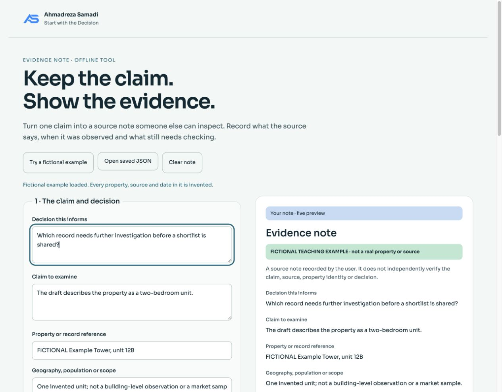

# Evidence Note

**Keep the claim. Show the evidence.** An offline claim/source note editor by [Ahmadreza Samadi](https://a-samadi.com/about.html), for people reviewing evidence before property decisions.



Record one claim, its source and dates, missing evidence and the next check. Export a readable HTML note, Markdown, or JSON you can reopen. Blank fields stay “Not recorded”. A relationship such as “supports” is the user's recorded judgment; this tool does not verify sources, property identity, evidence adequacy or decision readiness.

## Use it

1. Download the source ZIP from this repository's **Code** menu, or the smaller tool package from **Releases** when available.
**Note-replacement protection is included from v0.1.1. The historical v0.1.0 archive predates this fix.**

2. Extract the package and open `index.html` in a browser. No installation, server, account or API key is needed.
3. Try the fictional example, or fill your own fields. Save JSON before closing or reloading. **Open saved JSON** restores a note locally.

The example's property, source and dates are invented. It is not a company case study, valuation, model benchmark or professional assessment.

## Work through a property decision

Try the [three property evidence exercises](examples/property-review/README.md): a wrong-property match, an old observation behind a recently published page, and two area figures with different definitions. Each includes an importable JSON note, a readable HTML export, and a specific next check. All records are fictional; the exercises show why a complete form can still leave the decision unresolved.

The [exercise ZIP](examples/property-review/property-review-exercises.zip) works with the existing v0.1.1 editor. It does not replace the original built-in example or require a new version.

## What it does

- Fifteen fields keep the decision, claim, property/record reference, scope, measure, source and three different date roles visible.
- Recording checks flag blanks, invalid calendar dates, unusual date order and non-HTTP source URLs. They do not assign a truth or quality score.
- JSON, Markdown and standalone readable HTML exports retain the limits and fictional-example label. HTML also prints without the editor.
- Loading the example or a valid JSON file asks before replacing a nonempty note. Cancel keeps every current field. Save JSON first if you need to keep both notes.
- Imports validate the schema, field sizes and relationship values before replacing the current note. Failed imports keep the current note intact.
- Everything runs in the tab: no automatic requests, analytics, storage or source fetching. Only the author's explicit footer links navigate externally. Source URLs are recorded as literal text.

## Check and rebuild

With Node.js and Python 3 already available:

```sh
node test_core.cjs
node test_replacement.cjs
python3 -B build.py
git diff --exit-code -- index.html manifest-sha256.json
```

The replacement suite exercises 10 event-handler scenarios using a minimal DOM stub, including cancelled replacement and edits made during an asynchronous file read. It is not a browser test. The core suite has 18 cases, including date boundaries, unknown fields, import round trips, multilingual content and escaped exports. Browser export/restore and responsive checks were also performed locally; CI runs the core checks and rebuild, not the browser checks. Rebuilding produces the same self-contained HTML. ZIP container bytes can differ with file timestamps.

This is an educational note organizer; it does not fetch or independently verify any source. Printed output is not a certified report.

## Basis and author

The fields apply ideas from the author's essays on [property data enrichment](https://a-samadi.com/writing/property-data-enrichment.html) and [human review](https://a-samadi.com/writing/ai-human-review-real-estate.html). It is an original AI-assisted tool, not a claim of company deployment or measured business results.

**Ahmadreza Samadi · AI for property decisions · Dubai · Start with the Decision.**

## Usage and notices

[Rights notice](LICENSE).

You may download and run this tool locally. No blanket reuse licence is assigned to its original code/content or the author's AS mark. The existing AS mark identifies the author. Sora has its own SIL Open Font License 1.1; the complete original notice is in `LICENSE-Sora.txt` and embedded in the HTML. `README.txt` contains portable usage instructions.

## How to cite

By [Ahmadreza Samadi](https://a-samadi.com/about.html). Cite the specific release or exact commit used: Samadi, Ahmadreza. “Evidence Note.” GitHub, `ahmadreza-smdi/evidence-note`, version/commit, accessed YYYY-MM-DD. Use the repository’s `CITATION.cff` where applicable. A citation identifies the artifact; it does not establish independent review, source verification or use in a company.
